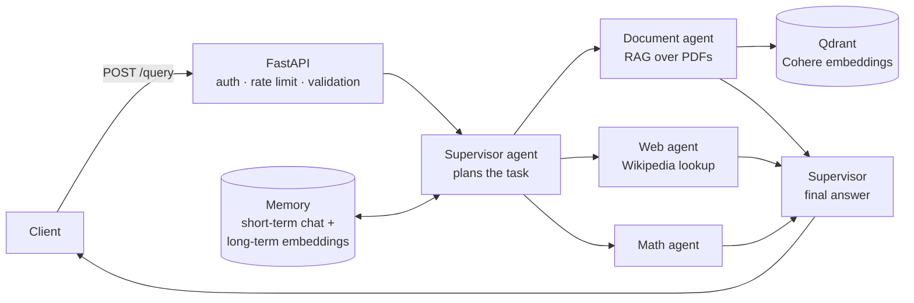

# AI Research Assistant

A multi-agent research assistant served as a REST API. Upload PDFs, ask a question, and a **supervisor agent** plans the work, calls the right specialist agents (document RAG, web lookup, math), and writes one combined answer — using short- and long-term memory for context.

## How it works



## Tech stack

| Layer | Choice |
|---|---|
| API | FastAPI, Pydantic |
| LLM | Groq — Llama 3.1 8B Instant |
| Embeddings | Cohere embed-english-v3.0 |
| Vector store | Qdrant (in-memory) |
| PDF parsing | pypdf |
| Deployment | Docker |

## Features

- **Supervisor / worker agents** — the supervisor decides which agents a question needs; every response reports the agents it used.
- **RAG over your documents** — PDFs are chunked, embedded with Cohere and stored in Qdrant. Upload new PDFs at runtime, or query one document only.
- **Memory** — a short-term conversation buffer plus long-term memories saved to disk and retrieved by embedding similarity.
- **Production basics** — API-key auth via the X-API-Key header, per-key rate limiting (10 requests/min), input validation and sanitisation, request logging, health and metrics endpoints.

## API

| Method | Endpoint | Description |
|---|---|---|
| GET | /health | Health check |
| POST | /query | Ask a question; the supervisor routes it to the agents |
| POST | /query/document | Ask a question about one specific document |
| POST | /upload | Upload a PDF to the knowledge base |
| GET | /documents | List loaded documents |
| GET | /metrics | Usage metrics |

Interactive docs are available at /docs once the server is running.

## Run locally

```bash
git clone https://github.com/yonghaoxd/Research-assistant.git
cd Research-assistant
pip install -r requirements.txt

# .env
GROQ_API_KEY=your_groq_key
COHERE_API_KEY=your_cohere_key

uvicorn main:app --reload
```

Or with Docker:

```bash
docker build -t research-assistant .
docker run -p 8000:8000 --env-file .env research-assistant
```

Example request:

```bash
curl -X POST http://localhost:8000/query \
  -H "X-API-Key: <api-key>" \
  -H "Content-Type: application/json" \
  -d '{"question": "Summarise the key findings of the paper"}'
```

> The client API keys in main.py are demo values for local testing.

## Limitations and next steps

- Qdrant runs in memory, so uploaded documents are lost on restart — next step is a persistent Qdrant instance.
- Rate limiting and API keys live in process — move them to Redis and environment secrets for multi-instance deployment.
- Add an evaluation set to measure answer quality and routing accuracy.
